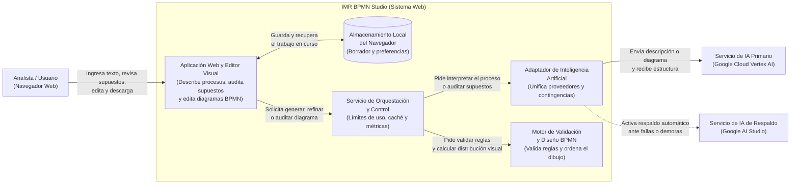

# Arquitectura de Alto Nivel — Contenedores (C4 Nivel 2)

- **Estado**: `as-built` (`v0.7.3`, verificado el `26/11/2026`).
- **Propósito**: explicar los grandes bloques constructivos del sistema y cómo se comunican entre sí en lenguaje accesible para perfiles técnicos y de negocio.
- **Detalle técnico (contratos, rutas y esquemas)**: ver [contracts.md](../architecture/contracts.md) y [architecture/README.md](../architecture/README.md).
- **Decisiones vinculadas**: [ADR-001](../architecture/decisions/ADR-001-bpmn-strategy.md), [ADR-002](../architecture/decisions/ADR-002-stack-and-hosting.md), [ADR-003](../architecture/decisions/ADR-003-llm-provider-adapter.md), [ADR-005](../architecture/decisions/ADR-005-tiered-llm-fallback.md), [ADR-006](../architecture/decisions/ADR-006-collaboration-and-events.md).

### Leyenda
- **Cajas dentro del recuadro**: bloques lógicos que conforman la aplicación (interfaz, almacenamiento en navegador, orquestación, adaptador de IA y motor BPMN).
- **Flecha continua**: flujo habitual de operación.
- **Flecha punteada**: ruta de contingencia para mantener la disponibilidad del servicio.
