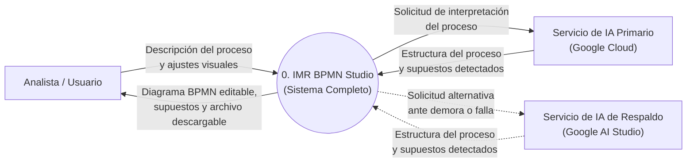

# DFD-0 — Diagrama de Contexto del Sistema

- **Alcance**: vista general de contexto de **IMR BPMN Studio** (*Texto a BPMN*).
- **Propósito**: mostrar los límites del sistema, las personas y servicios externos que interactúan con él y la información intercambiada, sin entrar en detalles internos.
- **Estado**: `as-built` (`v0.7.3`, verificado el `26/11/2026`).
- **Referencia**: [challenge.md](../brief/challenge.md) (`REQ-01`–`REQ-06`), [user-stories.md](../requirements/user-stories.md) (`US-01`–`US-08`).

### Leyenda
- **Círculo central**: representa todo el sistema como una sola unidad.
- **Línea continua**: flujo principal de información.
- **Línea punteada**: vía de respaldo que solo se activa si el servicio primario falla o se demora.

> **Nota sobre datos**: El sistema no utiliza una base de datos externa; el borrador en curso se resguarda únicamente en el navegador del propio usuario. Por ello, el DER físico se documenta como **no aplicable** (`ADR-002` y `ADR-004`).
