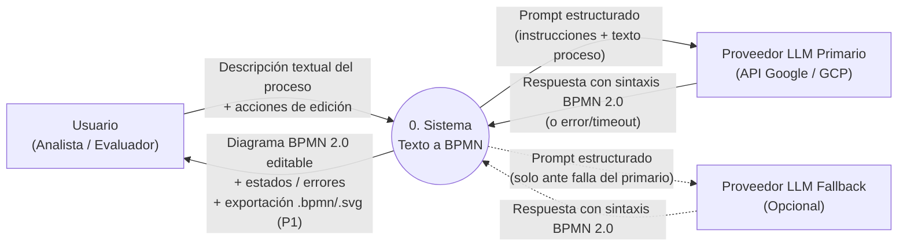

# DFD-0 — Diagrama de Contexto del Sistema

- **Alcance**: vista de contexto completo de la aplicación web *Texto → BPMN 2.0*.
- **Propósito**: delimitar las fronteras del sistema, entidades externas y flujos de datos principales (sin almacenes internos, conforme a notación DFD-0).
- **Estado**: `propuesto` (pendiente de aprobación humana).
- **Referencia**: [challenge.md](../brief/challenge.md) (`REQ-01`–`REQ-06`), [user-stories.md](../requirements/user-stories.md) (`US-01`–`US-06`).

> **Nota de modelado**: No se incluyen almacenes de datos ni base de datos porque la persistencia está fuera del alcance MVP (P2). Por el mismo motivo, el DER físico se marca como **no aplicable** mientras no exista almacenamiento persistente.
