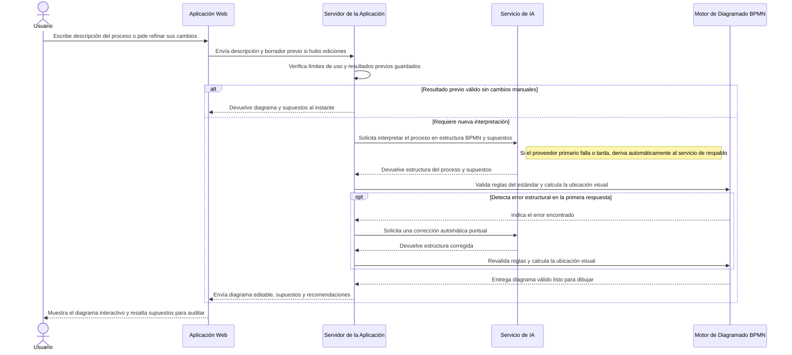
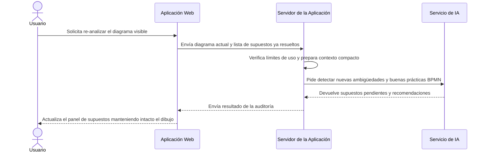

# Diagramas de Secuencia — Flujos Principales

- **Estado**: `as-built` (`v0.7.3`, verificado el `26/11/2026`).
- **Propósito**: describir paso a paso, de arriba hacia abajo, cómo colaboran las partes principales del sistema para cumplir los dos casos de uso centrales sin entrar en detalle de clases o código.

## Flujo A — Generar o refinar un diagrama desde texto

## Flujo B — Auditar supuestos sin alterar el dibujo actual

### Cómo leer estos diagramas
- El tiempo transcurre siempre **de arriba hacia abajo**.
- Los recuadros **`alt`** muestran caminos alternativos (por ejemplo, reutilizar un resultado previo vs. consultar a la IA); **`opt`** indica un paso opcional que solo ocurre ante errores.
