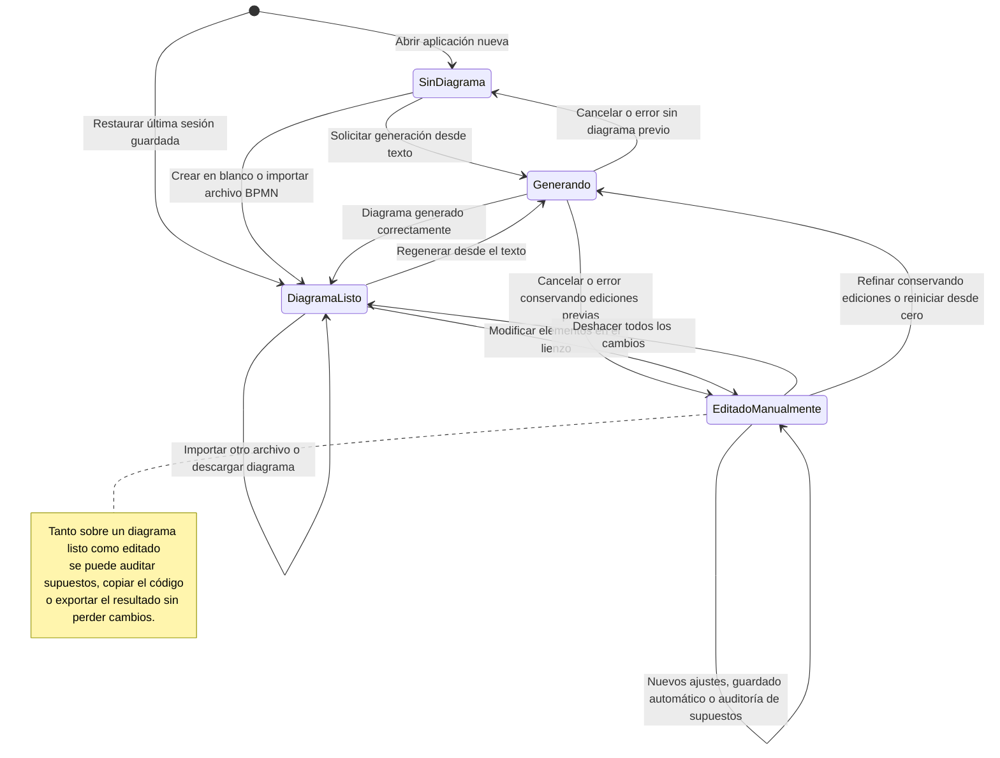

# Diagrama de Estados — Ciclo de Vida del Diagrama

- **Estado**: `as-built` (`v0.7.3`, verificado el `26/11/2026`).
- **Propósito**: mostrar los estados observables por el usuario durante una sesión de trabajo y qué acciones provocan el cambio de un estado a otro.

### Estados principales
- **Sin diagrama**: pantalla inicial lista para redactar una descripción, elegir un ejemplo o abrir un lienzo en blanco.
- **Generando**: espera activa con barra de progreso mientras se interpreta el texto y se diseña el diagrama (permite cancelar en cualquier momento).
- **Diagrama listo**: diagrama generado por IA, importado o en blanco, listo para inspeccionar, auditar o exportar.
- **Editado manualmente**: el usuario modificó elementos en el lienzo; el sistema protege esos cambios con guardado automático y permite refinar con IA sin sobrescribirlos.
